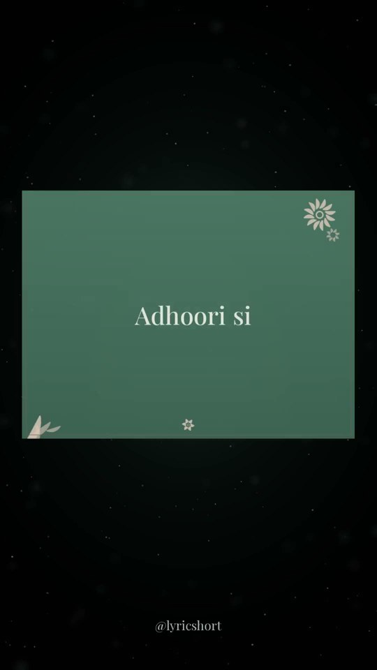
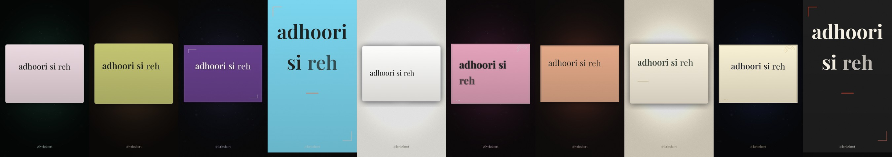
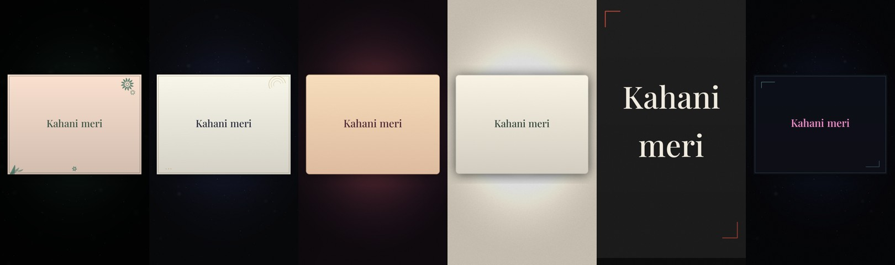

# lyric-short

Audio in → 9:16 lyric video out. Built for YouTube Shorts, Reels and TikTok.

Give it a song, a voice note or any audio file. It transcribes the words with
Whisper, cuts the transcript into short lyric cards, **designs a look for that
particular audio**, and renders a vertical video where every word appears in sync
with the voice.

The look is not a fixed template. You (or your agent) compose a design per video
from primitives — palette, background, card treatment, type, motion — so two
videos never come out the same. The six styles that ship with the repo are
reference points, and `designs/` holds hand-written examples.

```
audio.mp3 ──► ffmpeg ──► Whisper (word timestamps) ──► scene planner ──► design ──► renderer ──► short.mp4
```



## Design, don't template



Every frame above is the same lyric line, same code, different design: six moods
from the generator (`--design auto --mood …`) and three hand-written specs from
`designs/`.

```bash
# invent a design for this audio, and keep it so the look is repeatable
python -m lyric_short --audio song.mp3 --out short.mp4 \
       --design auto --mood warm --save-design designs/song.json

# or render a design you wrote yourself
python -m lyric_short --audio song.mp3 --out short.mp4 --design designs/ink_and_sun.json
```

A design is a small JSON file:

```json
{
  "name": "monsoon_note",
  "palettes": [
    {"fill": [38, 54, 62], "text": [238, 244, 240], "orn": [150, 180, 170]},
    {"fill": [238, 244, 240], "text": [38, 54, 62], "orn": [38, 54, 62]}
  ],
  "bg_mode": "bokeh", "bg_color": [6, 12, 14], "glow_color": [18, 34, 38],
  "card_mode": "rounded", "card_ratio": 0.90, "card_aspect": 1.32,
  "card_center_y": 0.46, "corner": 0.03,
  "ornament": "none", "text_align": "left", "accent_rule": true,
  "font_weight": 500, "text_size": 0.10,
  "transition": "fade", "zoom": 0.02, "grain": 0.03, "glow": 0.0
}
```

Full field list, taste rules and the agent workflow live in [SKILL.md](SKILL.md).
`python scripts/preview_designs.py` renders every mood plus every file in
`designs/` in a few seconds.

## Ready-made styles (shortcuts, not the point)



`botanical` · `midnight` · `sunset` · `paper` · `poster` · `neon` — plus `auto`,
which picks one from a hash of the file name, and `--vary`, which shifts the
palette so two runs differ.

| style | mood | card | motion |
| --- | --- | --- | --- |
| `botanical` | soft, acoustic, romantic | cream & sage frame, floral corners | fade |
| `midnight` | late night, lo-fi | navy card, brass arcs | fade + grain |
| `sunset` | warm, nostalgic | rounded plum & peach | slide |
| `paper` | poetry, storytelling | daylight, ink on paper | fade, tiny zoom |
| `poster` | hype, rap, hooks | full-bleed colour panels, huge type | pop cuts |
| `neon` | electronic, night drive | dark glass, glowing type | pop + glow |

## Install

```bash
git clone https://github.com/CyberGaurav404/lyric-short.git
cd lyric-short

python -m venv .venv && source .venv/bin/activate   # Windows: .venv\Scripts\activate
pip install -r requirements.txt
python scripts/fetch_fonts.py          # Playfair Display, SIL OFL
```

`ffmpeg` is required. If you do not have it system-wide, `pip install
imageio-ffmpeg` (already in `requirements.txt`) provides a bundled binary and the
tool finds it automatically.

## Use

```bash
python -m lyric_short --audio song.mp3 --out short.mp4 --handle "@yourname"
```

| flag | what it does |
| --- | --- |
| `--design auto` \| `path.json` | invent a design, or render one you wrote |
| `--mood calm\|warm\|dark\|bold\|minimal\|playful` | bias for `--design auto` |
| `--save-design d.json` | keep the design so you can re-render the same look |
| `--style …` | fallback look when no `--design` is given |
| `--vary` | nudge the palette so runs differ |
| `--preset shorts\|landscape\|square` | canvas shape (default `shorts` = 1080×1920) |
| `--model tiny\|base\|small\|medium\|large-v3` | Whisper model (default `small`) |
| `--language hi` | force a language instead of auto-detect |
| `--max-words 4 --max-chars 26` | how much text one card may carry |
| `--min-scene 1.5 --max-scene 4` | how long one card stays on screen |
| `--start-color a\|b` | which palette opens the video |
| `--handle "@yourname"` | small watermark near the bottom |
| `--limit 45` | only use the first 45 seconds |
| `--transcript t.json` / `--save-transcript t.json` | reuse / keep the Whisper output |
| `--dry-run` | print the card plan, render nothing |
| `--crf 20`, `--x264-preset veryfast` | quality vs size vs speed |
| `--list-styles` | print the six styles and their settings |

Typical run:

```
$ python -m lyric_short --audio song.mp3 --out short.mp4 --language hi --design auto --mood warm
[whisper] loading faster-whisper model 'small' (auto, int8)
[whisper] language=hi (p=0.98)
[design] warm-384f [warm] bg=gradient card=frame orn=none align=left trans=slide a=(137, 214, 205) b=(232, 239, 246) grain=0.074 glow=0.0
[scenes] 24 cards:
01    1.50–  3.10  a      kahani meri
02    3.12–  5.40  b      adhoori si
...
[render] warm-384f · 1080x1920 @ 30fps · 52.30s · 24 cards -> short.mp4
[done] short.mp4  (6.4 MB)
```

## How the scenes are decided

`lyric_short/scenes.py` does three things:

1. **Words** — takes Whisper's word timestamps when available; otherwise spreads
   the words of the segment evenly across its duration.
2. **Chunks** — greedily packs words into cards of at most `--max-words` words and
   `--max-chars` characters, so a card never holds a whole paragraph.
3. **Timing** — stretches a card to at least `min_scene` seconds, trims it to at
   most `max_scene`, and never lets it overlap the next card. Cards alternate
   palette from `--start-color`.

Reveal timing inside a card comes straight from the word timestamps, which is why
the text lands on the beat instead of drifting.

## Use it as an agent skill

[SKILL.md](SKILL.md) is written for an AI agent: how to read the material, how to
design a scene for it, the field-by-field design vocabulary, taste rules, a
verification checklist, and what to do when the transcript comes back wrong. Drop
the folder into an agent's skills directory, or point the agent at `SKILL.md`.

## Layout of the repo

```
SKILL.md         agent-facing instructions (design the scene, then render)
lyric_short/
  cli.py         argument parsing and the pipeline
  media.py       ffmpeg: probe, extract, encode, mux
  transcribe.py  faster-whisper / openai-whisper backends, transcript io
  scenes.py      transcript -> cards
  design.py      DesignSpec, generator (moods), contrast checks, json io
  render.py      frame loop, transitions, word reveals, grain
  art.py         backgrounds, cards, ornaments, text layout, heart
  config.py      Theme + Palette dataclasses, canvas presets
  styles.py      six reference styles, auto-style and palette variation
designs/         hand-written design specs
tests/           39 unittest cases (scenes, styles, design)
examples/        demo audio, demo transcript, rendered demos
scripts/         font download, demo audio, style and design previews
```

## Speed and memory

- Rendering is CPU-only; a 50-second short takes roughly 3–5 minutes on a laptop.
- The encoder runs with a single thread on purpose so it stays under ~1 GB of RAM.
  If a pipe encode still dies on a very small machine, the renderer automatically
  falls back to writing a PNG sequence and encoding from that.
- Whisper: `tiny` for drafts, `small` for real work, `medium`/`large-v3` when the
  lyrics matter and you have time. `--compute-type float16` with `--device cuda`
  is much faster on a GPU.

## Tests

```bash
python -m unittest discover -s tests -v
```

## Notes on copyright

The tool is a renderer — what you feed it is your responsibility. Do not publish
lyrics or recordings you do not have the rights to. Whisper will happily
transcribe a commercial song; that does not make the result yours to post.

## License

MIT for the code. Playfair Display is under the SIL Open Font License
(`assets/fonts/OFL.txt`). The demo audio in `examples/` is generated by
`scripts/make_demo_audio.py`, so it is free to use.
